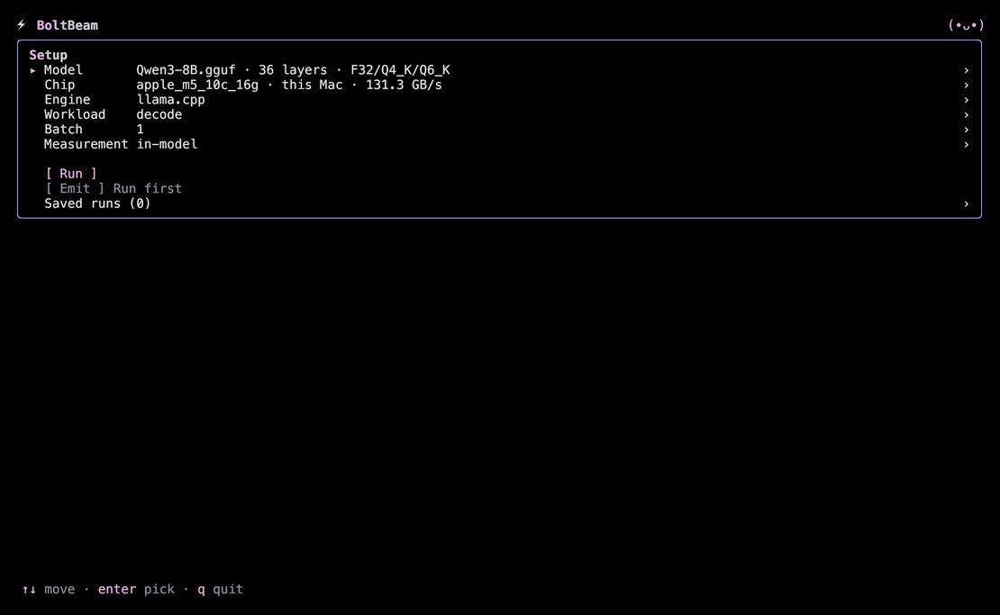

# BoltBeam

<!-- mirror-note: the public mirror inserts its note on the line below this one. Keep this marker. -->

> This is the public mirror of BoltBeam, the tool behind the write-ups on
> [research.arkey.ai](https://research.arkey.ai). It follows the project's `main` branch, which is the
> runnable product, the records of what was measured, and the raw evidence behind them (server logs,
> commands and traces, with machine paths redacted). Tests and experiments live on the inner branches and
> stay in the private repository (see `docs/branch-flow.md`).
> Published so the numbers in those articles can be checked. MIT licensed.


**Where does your model's inference time go, and how far is each part from what the chip can do?**

BoltBeam audits inference time against a measured roofline. It runs your model in a real engine, captures every
kernel, pairs each kernel with the model role it serves, and puts each one beside the fastest that role could run
on this chip. The chip's limits are measured on the chip, not read off a data sheet.



It answers, per role and per kernel:

- **How fast could it go?** The ceiling for each row: its bytes over the measured bandwidth, or its operations over
  the measured peak of the matrix path its instructions use, whichever binds. A second ceiling, "chip best", is the
  same work on the fastest path this chip has for those weights.
- **Where does the time go?** Every millisecond of a decode token, a prefill, a turn at session depth, or a replayed
  chat session, in ranked rows: ms now, ms at the limit, ms lost, and tokens per second if that row alone were fixed.
- **Does it add up?** The rows plus the idle gaps equal the captured time, and the captured time is checked against
  the untraced time over the same measured window: a capture qualifies when its overhead is within 5%, and a capture more than 5% faster is refused as not comparable.
- **Does a second engine agree?** The same model in another engine must show the same work and the same ceilings.
- **Did an engine upgrade change anything?** The engine-upgrade audit compares two builds row by row and names what
  moved beyond run-to-run noise ([docs/engine-upgrade-audit.md](docs/engine-upgrade-audit.md)).

Engines, by family (each a root and its forks, data/engine_families.json): llama.cpp (forks: Ollama, master), vLLM, TensorRT-LLM and arkey (BoltBeam's own provider: the owner's tinygrad fork). Chips: Apple Metal and NVIDIA CUDA, measured
the same way. BoltBeam says where the time goes. Why a kernel is slow is the engine developer's question. On Metal, llama.cpp names no
kernels in its capture. Qualified there: its whole decode token, its whole prefill at 512 tokens, and its
session turn at depth 512. The prefill and turn qualify only with the GPU idled 60 s before each arm, because
the M4's clock steps down under sustained load. Per-role time is the kernel timer's estimate
([docs/metal-qualification-20261023.md](docs/metal-qualification-20261023.md)).

## New in 0.3.26: a 128k session on one RTX 5090, 2.92x stock

Same engine, same model, same GPU: stock llama.cpp v1.0.0 against llama.cpp v1.0.0 set up by BoltBeam. Qwen3.8-Flash-Next
IQ1_M with its MTP draft head, a 59-turn coding session growing to 129k tokens, one user, batch 1, temperature 0.
RTX 5090 capped at 450 W, 31 GiB of RAM. Three paired runs; brackets are 95% intervals over the pairs.

| | stock llama.cpp | BoltBeam setup | gain |
|---|---|---|---|
| whole session | 485 s | 166 s | 2.92x [2.89, 2.94] |
| decode, whole session | 77 tok/s | 226 tok/s | 2.93x [2.90, 2.96] |
| decode, 96-128k tokens | 61 tok/s | 208 tok/s | 3.39x [3.35, 3.43] |
| prefill per turn | 2.61 s | 0.83 s | 3.14x [3.09, 3.18] |
| time to first token per turn | 2.71 s | 0.94 s | 2.90x [2.86, 2.94] |

Both setups draft 3 tokens a step with the same head and accept about the same. The gain is the step time.

What does it:

- **Engine mods.** `boltbeam mods --apply` applies the opt-in llama.cpp mods of
  [arkey_ie_mods](https://github.com/JulianAbeleda/arkey_ie_mods) (MIT, public) to your llama.cpp, a tree without
  `.git` (a release archive) included. It builds the series, checks each mod is on, and refuses a build whose
  generated kernels did not load. 13 mods for v1.0.0, each off unless its switch is set. 12 compute the same bits as
  stock; 1 changes only the draft's proposals. One is the first generated kernel package: two BF16 GEMV kernels
  written by arkey's scheduler, -0.56 ms a step, identical output.
- **`tune` and `offload` derive the settings**: the prefill chunk (`-ub 1024`), the expert placement and cache size, and
  `-lm none` when the model files are larger than RAM and the host experts fit in it. `-lm none` reads the host experts
  into RAM at load; output identical. It fixed the cold first turn: 2.5 s of prefill against 5.3-6.8 s for stock.
- **`context-audit`**: the long-context audit as checks. Each part of a decode step placed from measured GPU idle time,
  host CPU time per host function, minimum memory per role on a ledger. Labels fail closed when an input is missing
  ([docs/context-audit.md](docs/context-audit.md)).
- **`kernel-ledger`**: every kernel in a decode step against its own limit ([docs/kernel-ledger.md](docs/kernel-ledger.md)).

**Quality.** The mods are identical to stock but one (draft only). The settings change rounding, so the setup is not
bit-identical and is gated instead, with every rule fixed before the run:

1. Distribution gate: every next-token distribution of 18 replies (4,608 positions) against floor pairs that differ only
   by rounding stock already accepts (CPU vs GPU, cache size, batch size). Fail at 2 replies past the widest floor
   flip. Result: 0. Holds.
2. MMLU-Pro, 150 items, non-inferiority: stock 103, BoltBeam setup 104. Pass.
3. LiveCodeBench, 140 items, non-inferiority: stock 69, BoltBeam setup 73 (McNemar p = 0.66: no harm, no gain). Pass.

Limits: one RTX 5090, one model, one session shape. Other cards and models are unverified until run. One user at a
time. `-lm none` holds the host experts in RAM from load; with every expert in RAM they do not fit 31 GiB beside the
checkpoint pool, so `tune` and `offload` leave that setup mapped.

Test machine and per-mod numbers: [arkey_ie_mods#test-machine](https://github.com/JulianAbeleda/arkey_ie_mods#test-machine).
Method, every run and the commands to reproduce:
[arkey_ie_mods/benchmarks](https://github.com/JulianAbeleda/arkey_ie_mods/tree/master/benchmarks/llama.cpp-1.0.0-0.3.26).

## Install

On a Mac with Homebrew:

```bash
brew install JulianAbeleda/tap/boltbeam
```

`boltbeam` opens the screen and offers a newer release when there is one (`boltbeam update` checks by hand;
`brew update && brew upgrade boltbeam` takes it). Runs are kept in `~/boltbeam-runs`.

From source, with Python 3.10 or newer. No dependencies.

```bash
git clone https://github.com/JulianAbeleda/BoltBeam-Public.git
cd BoltBeam-Public
python3 -m pip install .
```

A stock macOS names Python 3.9 as `python3`. BoltBeam refuses it and says so. Name a newer one, for example
`python3.12 -m pip install .`. Without installing, `python3 -m boltbeam.cli <command>` does the same as
`boltbeam <command>`. `boltbeam selfcheck` runs the core path on a tiny synthetic model, with no GPU and no model
file, and prints PASS or FAIL per step.

On Linux with an NVIDIA GPU, [docs/linux.md](docs/linux.md) goes from a bare Ubuntu to the first report. On a
rented GPU (RunPod, Vast.ai), `tools/pod-setup.sh` does it in one command ([docs/pods.md](docs/pods.md)).

## Your first run, in five minutes

You need one model file the engine reads (a GGUF for llama.cpp) and the engine. These steps ran on a MacBook Air
(M3) with Homebrew's llama.cpp and a 270M-parameter Q8_0 GGUF.

**1. Check the machine.**

```bash
boltbeam doctor
```

```text
python         found      3.12.13 (/opt/homebrew/opt/python@3.12/bin/python3.12)
GPU            found      Apple M3
chip profile   found      apple_m3_10c (built in)
llama.cpp      found      /opt/homebrew/bin/llama-bench (path); per-role time: boltbeam-kernel-timer-isolated
vllm           n/a        BoltBeam runs vLLM on NVIDIA GPUs only; apple_m3_10c is Metal
capture tool   not found  metal-system-trace is not installed
                          -> install Xcode (xctrace comes with it)
Go             found      go1.26.5 at /opt/homebrew/bin/go
...
```

One row per thing BoltBeam can use, and one fix per gap. It always exits 0. What matters for a first run:

- **chip profile.** If it says `not found`, run the command it prints (`python -m boltbeam.workflow.screen
  autoscan`). That measures this GPU's bandwidth and compute peak once, in about a minute. A run does not do it for
  you, and without it every ceiling is refused.
- **an engine** that says `found`.
- **capture tool.** Without it, per-role time on a Mac uses BoltBeam's kernel timer: each of the engine's own
  kernels timed alone ("isolated"). With Xcode it is a capture of the real token ("in-model").

**2. Run one audit.** Either on the screen:

```bash
boltbeam tui
```

Setup opens with this machine's chip and the first engine found. Pick the model (Setup lists the files in
`~/models`, or type a path), leave the workload on `decode`, and press **Run**. On the M3 the run took about 30 seconds. Or from the command line, with the chip id doctor printed:

```bash
python -m boltbeam.workflow.screen pipeline model.gguf --run runs/first --target apple_m3_10c \
  --provider llama.cpp --workload decode --analyze --no-search
```

This one took 11 seconds. It writes `runs/first/report.html` (the report) and `runs/first/summary.md` (the same, as text).

**3. Read the result.** The top of the page, from the M3 run:

```text
⚡ 215.4 tokens per second measured. The limit is 342.2.
█████████████░░░░░░░ 63% of the limit
⚠ Engine build: llama.cpp build 48d22e295 is NOT the pin b11571 (097cf33d9): this run measured another build.
Measured with llama.cpp · isolated, timed by BoltBeam's kernel timer
Where the token goes (estimate)
ROW               MS NOW  MS AT LIMIT  MS AT CHIP BEST  MS LOST  SHARE  TOK/S IF FIXED  % OF PEAK
ffn_gate_up Q8_0  1.44    0.51         0.51             0.92     54%    268.8           23.3%
attn_qo Q8_0      0.38    0.13         0.13             0.25     15%    227.7           22.0%
attn_kv Q8_0      0.25    0.06         0.06             0.19     11%    224.5           16.6%
...
= token           4.64    2.95         2.95             1.70     100%
Per-role repeat check: not checked: no repeat band matches this setup.
```

- The headline is the untraced decode against the roofline: 63% of what this chip allows for this model.
- Each row is one role. **MS LOST** is how far it is from its limit. **TOK/S IF FIXED** is what fixing that row
  alone is worth. Here the feed-forward input projection loses the most: 0.92 ms of 1.70.
- "(estimate)" means the kernels were timed alone, not inside the token. A capture tool removes the estimate.
- The engine build is checked against BoltBeam's pinned version. A different build is measured and said, not refused.

**4. Run it twice.** A first run always says **not checked**. That is expected, not a fault. A verdict ("moved",
"within repeat noise") needs to know how much the same setup moves between two runs. Run the identical setup
again, derive the repeat bands, and give them to later runs:

```bash
python -m boltbeam.workflow.screen pipeline model.gguf --run runs/second --target apple_m3_10c \
  --provider llama.cpp --workload decode --analyze --no-search
python -m boltbeam.workflow.screen repeat-bands --before runs/first --after runs/second --out bands.json
python -m boltbeam.workflow.screen pipeline model.gguf --run runs/third --target apple_m3_10c \
  --provider llama.cpp --workload decode --analyze --no-search --bands bands.json
```

The third run reads `Per-role repeat check: 5 of 5 roles checked against the measured repeat band of this setup.`
Bands belong to one exact setup: the same chip, engine build, model, workload, contexts and settings. They are never
borrowed from another.

The workload picker offers four different measurements:

| Workload | What the run measures |
| --- | --- |
| Decode | Generated-token throughput at the requested cache depths. |
| Prefill | Prompt throughput at the requested prompt lengths. |
| Session | A fresh turn appended at each cache depth, decode, cache reuse and compaction. |
| Replay | A sequence of turns on a server, including client latency, server timing and cache reuse. |

A valid report means its accounting checks passed. Timing confirmation and token agreement have their own
verdicts. Session runs retain cold and cached token/probability samples by depth in `session_reference.json`;
`FAIL` in the next-token column means that comparison failed even if timings are available. Replay benchmark
captures describe a separate invocation. Timer agreement alone cannot establish the server's execution path;
server attribution requires matching recorded intervals and repeat-band checks. Read those limits in Run and
Emit before using a capture to explain server latency.

Timing confirmation compares matching engine elapsed intervals. GPU first-to-last kernel time is a separate
measurement and excludes host work. Prefill and session retain five repetitions after warmup, treating the first
two as setup. Their host check uses the median of repetitions three through five; kernel attribution selects
that exact captured repetition by its ordered full-turn launches and output-head boundaries. Throughput headlines
use the same steady median; all five samples and the engine's aggregate remain separately recorded. Earlier
final-repetition bands cannot qualify this steady interval. Decode subtracts a fresh two-token setup run from
a fresh 33-token run, attributing steady tokens 3–33 after initial graph construction. Earlier 32/1 records
retain their original scope and verdicts. Both sides retain subtraction noise and both the
requested depth and mean attended context. Older kernel-span bands cannot qualify these host intervals.
Matching the interval establishes comparability. A capture then qualifies when its measured overhead,
`100 * (captured - native) / native`, is at most the 5% capture-overhead ceiling. A capture more than 5% faster than native is refused as not
comparable: the two arms then differ in more than the capture.
Run and Emit show that signed overhead beside every checked verdict, for example `capture +1.65% over native, within
the 5% capture-overhead ceiling`. Nothing is subtracted from any number. A qualified capture shows its projected
gains; one above the ceiling, or with unmatched windows, withholds them. For these captures the repeat band is
reported as repeat noise and no longer gates the end-to-end verdict. Replay turns qualify the same way: the server
itself is profiled in native and profiled pairs after an unmeasured warm-up server, and each turn's overhead is
checked against the ceiling.
Session correctness references disable automatic server checkpoints so cached and cold paths use the benchmark's
batching. Warm-cache rows retain the actual number of tokens recomputed; a repeated prompt can require a full
re-evaluation on recurrent models without rollback checkpoints.

## Next steps

| you want to | read |
|---|---|
| prefill, session depth, or a replayed chat session | the Workload line in Setup; `--workload prefill`, `session`, `replay` ([tui/README.md](tui/README.md)) |
| compare two engines, or two builds of one engine | [docs/engine-upgrade-audit.md](docs/engine-upgrade-audit.md); on the screen, Saved runs, then Compare |
| time your own kernel against the roofline | [docs/guide-time-your-kernel.md](docs/guide-time-your-kernel.md) |
| add an engine | [docs/guide-add-an-engine.md](docs/guide-add-an-engine.md) |
| engine mods: where they live (arkey_ie_mods), applying them to your build | [docs/engine-mods.md](docs/engine-mods.md) |
| use the screen and its JSON mode for agents | [tui/README.md](tui/README.md) |
| the command line end to end | [docs/CLI.md](docs/CLI.md) |
| how the timer and its limits were measured | [docs/kernel-timer.md](docs/kernel-timer.md) |
| everything else | [docs/README.md](docs/README.md) |
| work on BoltBeam itself | [docs/maintaining.md](docs/maintaining.md) |

## Check the article numbers

The write-ups on [research.arkey.ai](https://research.arkey.ai) cite files in this repository by path.
Each cited number lives in one of these places:

| what the article says | where it comes from |
|---|---|
| a chip's memory speed, matrix peak, SM count | `boltbeam/data/targets.json`, with the measurement in `bench/<target>-facts-<date>/README.md` |
| every weight, KV-cache and activation format: how it packs, its refuted routes, each component's support | `boltbeam/data/formats.json` ([docs/formats.md](docs/formats.md)) |
| a route was promoted or refuted, and why | `boltbeam/data/candidates.json` (the candidate registry) |
| a closed experiment and its numbers | the cited record in `docs/`, for example `docs/14b-aggregate-fusion-closeout-20260702.md` |
| the speed limit for a model on a chip | rerun it: `boltbeam roofline-theoretical MODEL.gguf --target TARGET --context 1` |

`bench/` holds the raw measurement records. [docs/README.md](docs/README.md) lists the records the
articles cite.

Engine discovery is cached between TUI launches. Use **Engine → Scan again** after installing a new engine.
Changes to engine environment settings or missing cached paths trigger a fresh scan automatically.

Work breakdowns share bordered tables with centered numbers and sections for model operations, supporting kernels,
and timing adjustments across decode, prefill, and replay. Decode shows additive estimated tok/s gains and cumulative
throughput for both GGUF and captured engine reports. Prefill/replay retain their workload units and attribution limits;
unknown ceilings are not measurements of recoverable savings.

Emit writes `gameplan.md` and `gameplan.json` from a completed, validated run. Captured-engine reports
(including vLLM NVFP4/AWQ), prefill, and session/replay work breakdowns produce a shared gap report
with measured timings, modeled differences, unknown ceilings, timing corrections, and evidence.
Runs with kernel-search evidence retain their implementation-specific gameplans. Emit does not apply changes.
